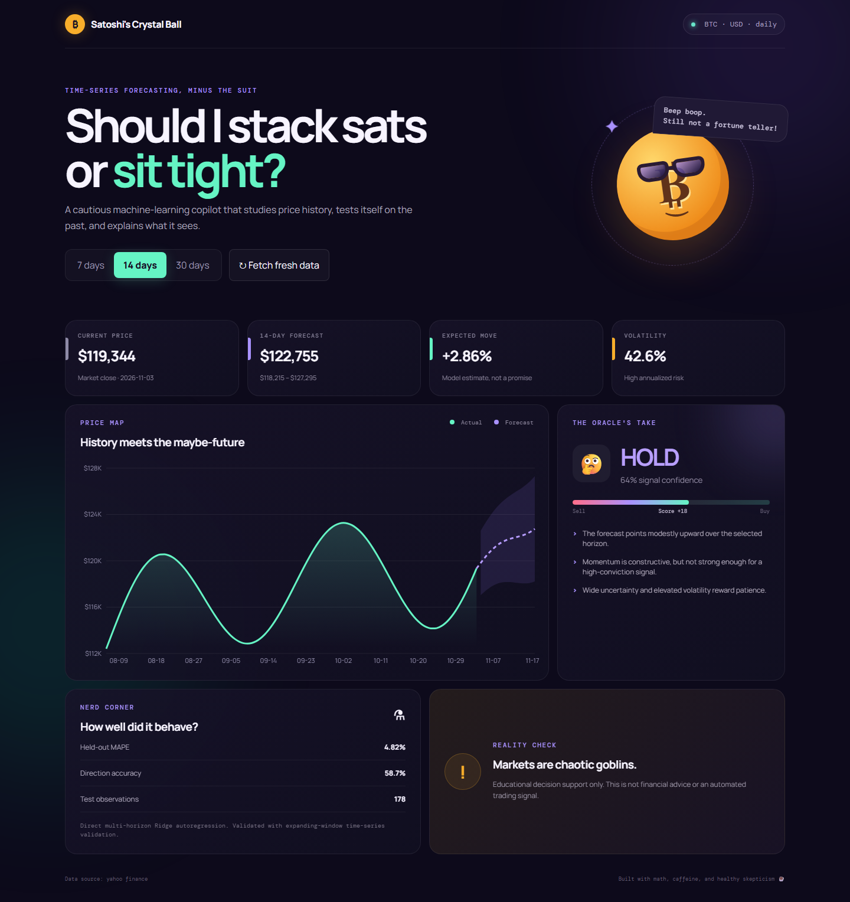
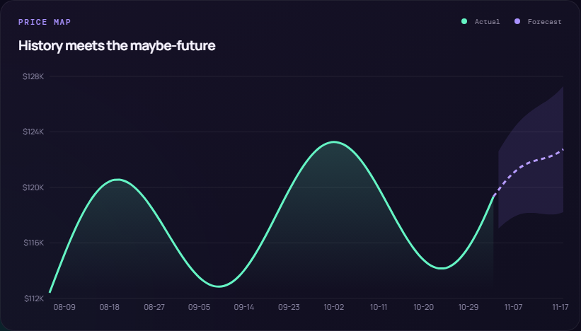
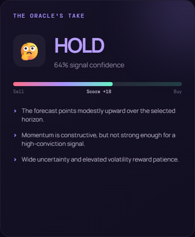

<p align="center">
  
</p>

<h1 align="center">Satoshi's Crystal Ball</h1>

<p align="center">
  <strong>Uncertainty-aware Bitcoin forecasting and explainable decision support.</strong><br />
  From clean daily market data to a 1–30 day forecast and a transparent BUY / HOLD / SELL signal.
</p>

<p align="center">
  
  
  
  
  
</p>

> [!CAUTION]
> Educational decision support only—not financial advice or an automated trading system. Crypto assets can lose substantial value.

## See it in action

<p align="center">
  
</p>

<table>
  <tr>
    <td width="64%"></td>
    <td width="36%"></td>
  </tr>
  <tr>
    <td align="center"><strong>Forecast, not a promise</strong><br />A daily path with a 90% uncertainty band.</td>
    <td align="center"><strong>Decision, with reasons</strong><br />Signal, score, confidence, risk, and evidence.</td>
  </tr>
</table>

## Why this project

Many price demos stop at drawing a line. This project treats the surrounding engineering as part of the model: it cleans and validates upstream data, avoids random train/test leakage, reports holdout behavior, visualizes uncertainty, and explains how the final signal was formed.

| Layer | What it does |
| --- | --- |
| **Market data** | Fetches keyless BTC/USD OHLCV from Yahoo Finance, or CryptoCompare when configured; validates, cleans, de-duplicates, interpolates missing days, clips volume outliers, and caches locally. |
| **Features** | Builds 14 return lags, moving-average ratios, 7/30-day momentum, 14/30-day volatility, RSI(14), and normalized volume. |
| **Forecast** | Fits a direct multi-horizon NumPy Ridge autoregression, selects regularization with expanding-window validation, blends it with robust recent drift, and reserves the final 20% for evaluation. |
| **Decision** | Combines risk-adjusted expected return, trend, RSI, uncertainty, and volatility into an explainable BUY / HOLD / SELL score. |
| **Delivery** | Serves a FastAPI backend and responsive React/Recharts dashboard through Docker Compose and Nginx. |

## How the signal is made

```text
BTC/USD candles
      ↓ validate · clean · cache
time-series features
      ↓ expanding-window validation
Ridge + robust-drift ensemble
      ↓ forecast path + 90% interval
risk · trend · RSI · confidence
      ↓
BUY / HOLD / SELL + plain-language reasons
```

The result is intentionally conservative: a directional forecast alone is not enough. The predicted move must also clear a volatility-aware materiality threshold before the system emits BUY or SELL.

## Quick start

### Docker (recommended)

```bash
docker compose up --build
```

Then open:

- Dashboard: <http://localhost:3000>
- Interactive API docs: <http://localhost:8000/docs>
- Health check: <http://localhost:8000/api/health>

Stop the stack with `docker compose down`. The market-data cache remains in the `bitcoin_data` volume; use `docker compose down -v` only when you also want to remove it.

### Local development

Backend (Python 3.11+):

```powershell
cd backend
python -m venv .venv
.venv\Scripts\Activate.ps1
pip install -r requirements-dev.txt
uvicorn app.main:app --reload
```

Frontend (Node 20+), in another terminal:

```bash
cd frontend
npm install
npm run dev
```

Vite proxies `/api` to `http://localhost:8000`.

## API

| Method | Route | Purpose |
| --- | --- | --- |
| `GET` | `/api/health` | Service health |
| `GET` | `/api/history?days=365` | Clean daily OHLCV history |
| `GET` | `/api/analyze?horizon=14&history_days=900` | Forecast, metrics, indicators, and decision |
| `POST` | `/api/refresh?horizon=14&history_days=900` | Force a fresh crawl before analysis |

`horizon` accepts 1–30 days. `history_days` accepts 180–2000 days.

## Data sources and configuration

No key is required for the default Yahoo Finance source. To use CryptoCompare, copy `.env.example` to `.env` and set `CRYPTOCOMPARE_API_KEY`; Docker Compose loads it automatically.

| Variable | Default | Description |
| --- | --- | --- |
| `CRYPTOCOMPARE_API_KEY` | empty | Enables CryptoCompare as the upstream source |
| `CACHE_TTL_MINUTES` | `60` | Cache freshness window |
| `CACHE_FILE` | `data/bitcoin_usd_daily.csv` | Local OHLCV cache path |
| `REQUEST_TIMEOUT_SECONDS` | `20` | Upstream request timeout |
| `CORS_ORIGINS` | local frontend URLs | Comma-separated allowed origins |

## Quality checks

```bash
cd backend
pytest -q

cd ../frontend
npm run build
```

The backend suite covers the API, crawler behavior, model outputs, and decision logic.

## Modeling limits

Bitcoin is non-stationary and sensitive to regime changes, liquidity shocks, regulation, and news that historical candles cannot capture. The interval is estimated from recent holdout residuals and may be too narrow in a new crisis. Historical MAE, MAPE, and directional accuracy do not guarantee future performance.

For serious research, add transaction costs, walk-forward trading simulation, redundant data sources, monitoring, drift alerts, and independent risk limits.

---

<p align="center">Built for reproducible experimentation—not fortune-telling.</p>
